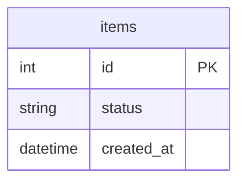

# ERD

[← README](../../README.md)

> 공통 DB 규칙은 [CLAUDE.md](../../CLAUDE.md#3-db-규칙)를 따릅니다. 아래 ERD 그림은 형식 예시이며 실제 업무 설계가 아닙니다.
>
> 외부 도구로 써도 됩니다(추천: [dbdiagram.io](https://dbdiagram.io), [ERDCloud](https://www.erdcloud.com)). 그 경우 이 파일에는 링크와 한 줄 요약만 남깁니다.

- Auth·Menu·Inventory·Order·Payment·Cooking은 각각 독립 DB를 가집니다. dev 6개 + prod 6개 = 총 12개이며 스키마 분리로 대체하지 않습니다.
- 다른 서비스의 DB에 직접 접근하지 않습니다.
- 테이블은 복수형 snake_case, 컬럼은 snake_case를 사용합니다.
- DB 구조 변경은 Flyway 마이그레이션으로만 수행합니다. 수동 DDL이나 ddl-auto로 스키마를 변경하지 않습니다.
- DB 구조·마이그레이션 변경 PR은 필수 리뷰 대상입니다.
- [dbdiagram.io](https://dbdiagram.io)의 DBML 또는 아래처럼 Mermaid로 씁니다

## <서비스 A>

## DB 테이블 변경 · 시드 데이터
| 항목 | 방법 |
|---|---|
| 테이블 변경 | Flyway 마이그레이션 |
| 시드 데이터 | <scripts/seed 실행 방법> |

## Notion 설계 초안

- [현재 ERD 초안](notion-draft.md): 서비스별 ERD, 설계 이유, 미결정 사항과 수정 기록을 보존했습니다.
- [보관용 옛 ERD](archive/notion-legacy.md): Notion 원문에서 과거 자료로 구분한 설계이며 현재 구현 기준으로 사용하지 않습니다.

현재 ERD도 초안 상태입니다. Notion의 Mermaid 원문을 보존했으며 DBML 원본을 임의로 생성하지 않았습니다. 문서 보관은 DB 변경이나 Flyway 마이그레이션 실행을 의미하지 않습니다.
