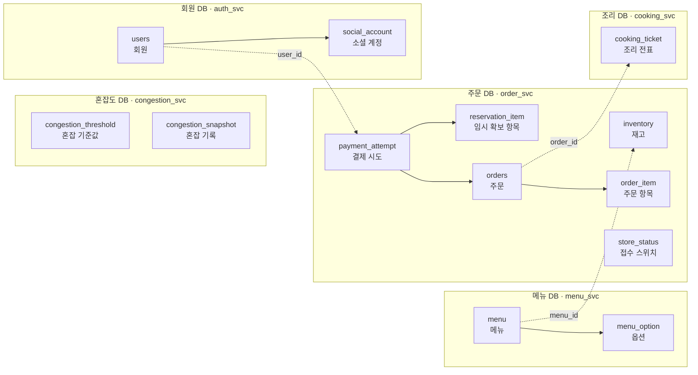
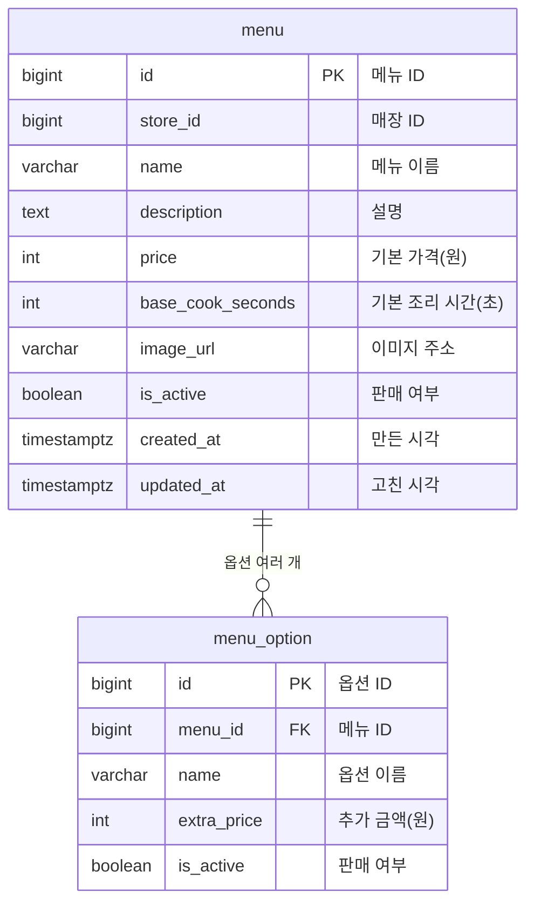
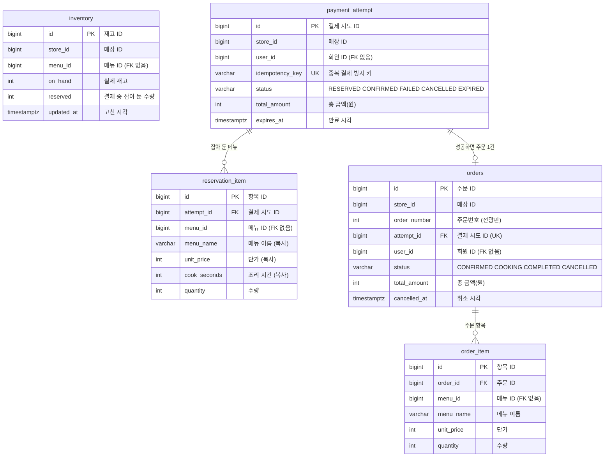
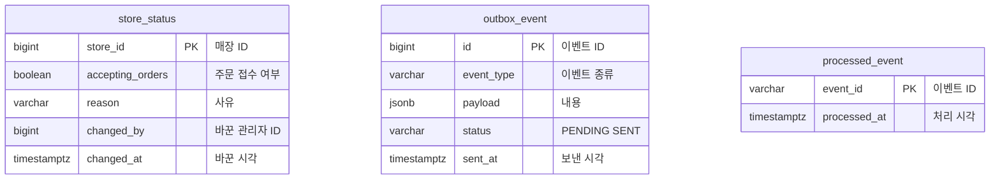
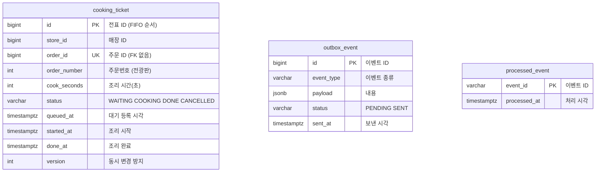
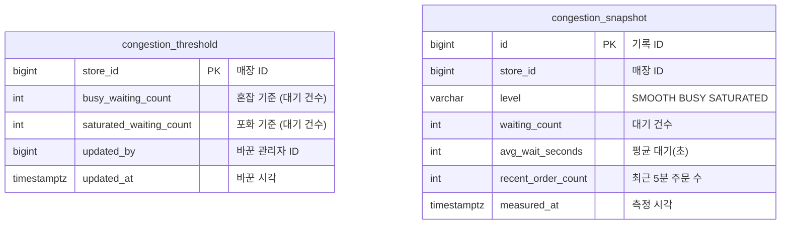
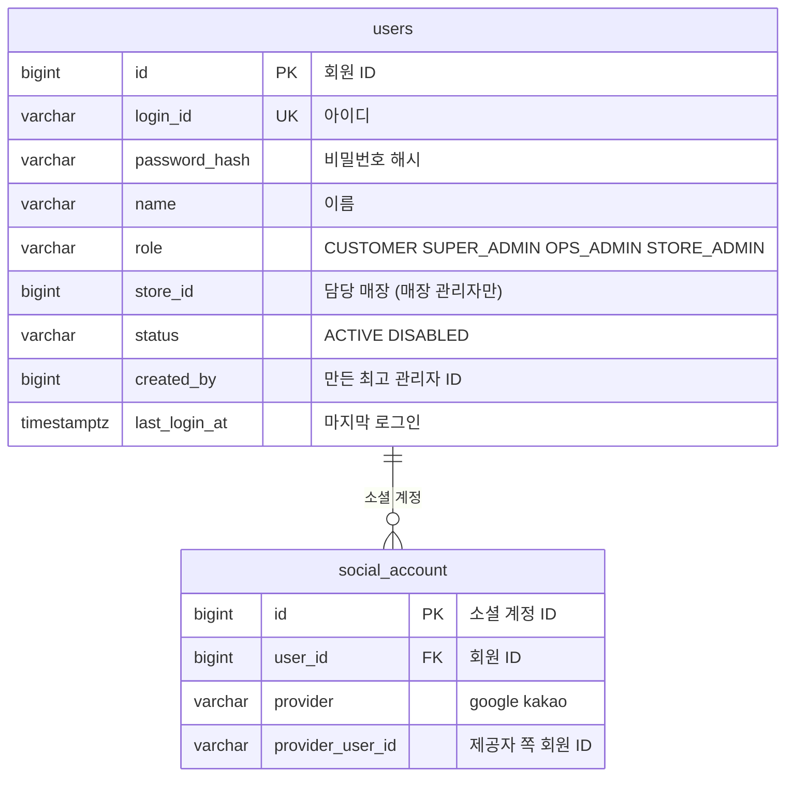

# 보관용 옛 ERD — 현재 구현 기준으로 사용하지 않음

> Notion 원문의 초안을 보관한 문서입니다. Git에 추가했다는 이유로 팀 승인·구현 완료를 의미하지 않습니다.

- 원본: [ERD 초안](https://app.notion.com/p/4102f07e947880fb87eac2ab3ffc68a2)
- 원본 최종 수정: 2026-11-13T03:41:37.090Z (UTC)
- 가져온 날짜: 2026-11-13 (Asia/Seoul)
- 공통 확정 규칙: [CLAUDE.md](../../../CLAUDE.md)
- 변경 범위: 문서 형식 변환·자료 분리. API 경로, 필드, 테이블, 상태 및 미결정 사항은 원문을 유지합니다.

---

> 이 자료는 원문에서 이미 과거 설계로 구분되어 있습니다. 서비스 구성·테이블명 등에 현행 규칙과 다른 내용이 있으므로 현재 구현에 적용하지 않습니다.

## 1. ERD가 뭔가요?

ERD(Entity Relationship Diagram)는 **DB에 어떤 표를 만들고, 표끼리 어떻게 이어지는지** 그린 설계도입니다.

| ERD 용어 | 쉽게 말하면 | 예시 |
| --- | --- | --- |
| 테이블(표) | 엑셀 시트 한 장 | `orders` = 주문 시트 |
| 컬럼 | 시트의 열(칸 제목) | `order_number`, `status` |
| 행 | 시트의 한 줄 = 데이터 1건 | 주문 1건 |
| 관계(연결선) | 시트끼리 "이 줄은 저 줄과 관련 있음" | 주문 1건에 주문 항목 여러 개 |

## 2. 그림 읽는 법

| 표시 | 뜻 |
| --- | --- |
| **PK** (Primary Key) | 한 줄을 구분하는 번호. 주민번호처럼 겹치지 않음 |
| **FK** (Foreign Key) | 다른 표의 PK를 가리키는 칸. DB가 "없는 번호는 못 넣게" 막아 줌 |
| **UK** (Unique Key) | 표 안에서 같은 값이 두 번 들어갈 수 없는 칸 |
| **실선** | 같은 서비스 DB 안의 진짜 연결(FK 있음) |
| **점선** | 다른 서비스 표의 ID만 적어 둔 것(FK 없음, 필요하면 API로 물어봄) |
| 선 끝이 **새발(여러 갈래)** 모양 | "여러 개" 쪽. 예: 주문 1건 ↔ 주문 항목 여러 개 |
| 선 끝이 **동그라미 + 막대** | "없거나 1개" 쪽. 예: 결제 시도 1건 ↔ 주문 0\~1건 |

## 3. ERD

표가 20개라 한 장에 다 넣으면 글자가 너무 작아져서, **전체 지도 1장 + 서비스별 상세 6장**으로 나눴습니다. 코드 블록 위 보기 방식을 **미리 보기**로 바꾸면 그림이 보이고, 표를 고치려면 해당 블록의 코드를 직접 수정하면 됩니다.

### 3-1. 전체 지도 — 서비스와 연결만

표 안의 칸은 빼고 **어떤 표가 어느 서비스에 있고, 서로 어떻게 이어지는지**만 보여 줍니다. 실선은 같은 DB 안의 FK, 점선은 서비스 간 ID 참조입니다. (이벤트용 표 `outbox_event`, `processed_event`는 3-4, 3-5에)

### 3-2. 메뉴 (menu\_svc)

### 3-3. 주문·재고 (order\_svc) — 핵심 흐름

결제하기를 누르면 `payment_attempt`와 `reservation_item`이 생기고, 결제에 성공하면 `orders`와 `order_item`이 생깁니다. `inventory`는 메뉴 ID로만 메뉴 서비스를 가리킵니다.

옵션 칸(`option_id`, `option_name`)과 `created_at`, `updated_at`은 그림을 단순하게 하려고 뺐습니다. 전체 칸은 dbdiagram 원본에 있습니다.

### 3-4. 주문 서비스의 운영·이벤트 표 (order\_svc)

### 3-5. 조리 (cooking\_svc)

### 3-6. 혼잡도 (congestion\_svc)

### 3-7. 회원 (auth\_svc)

