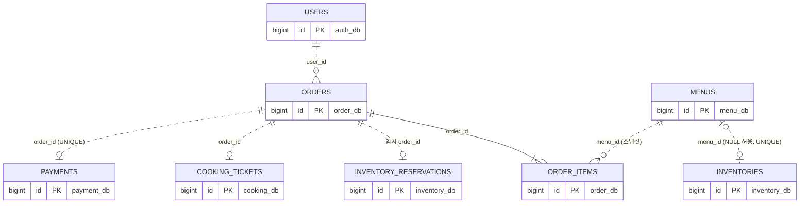
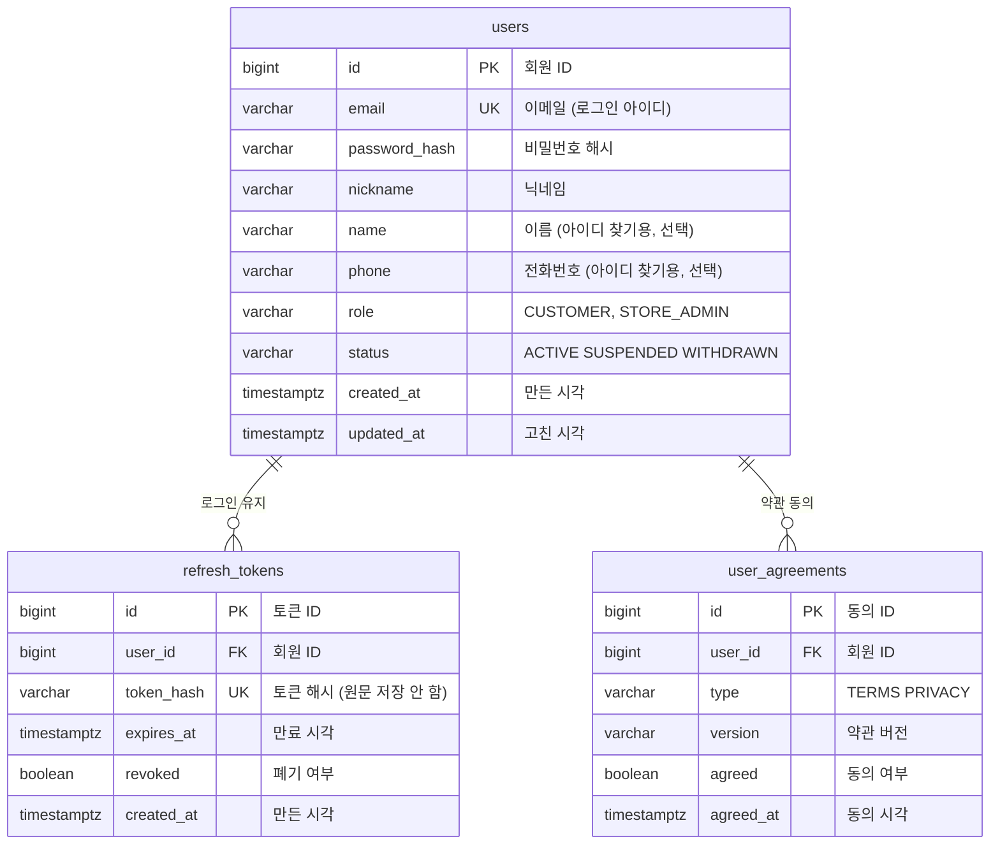
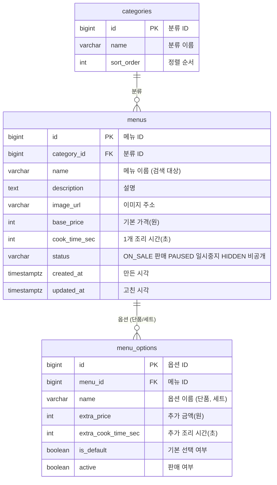
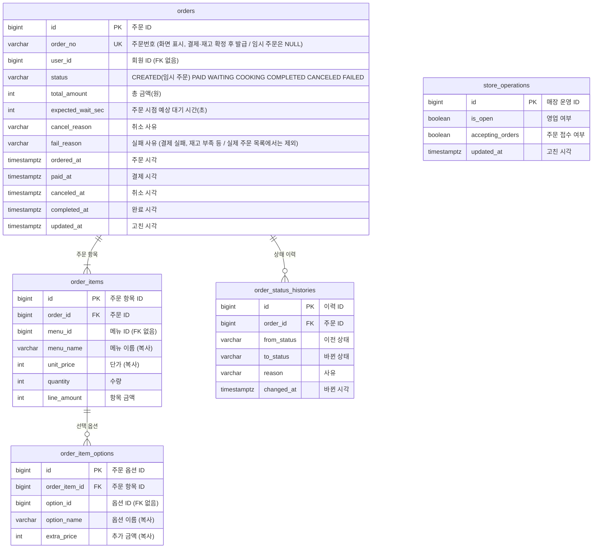
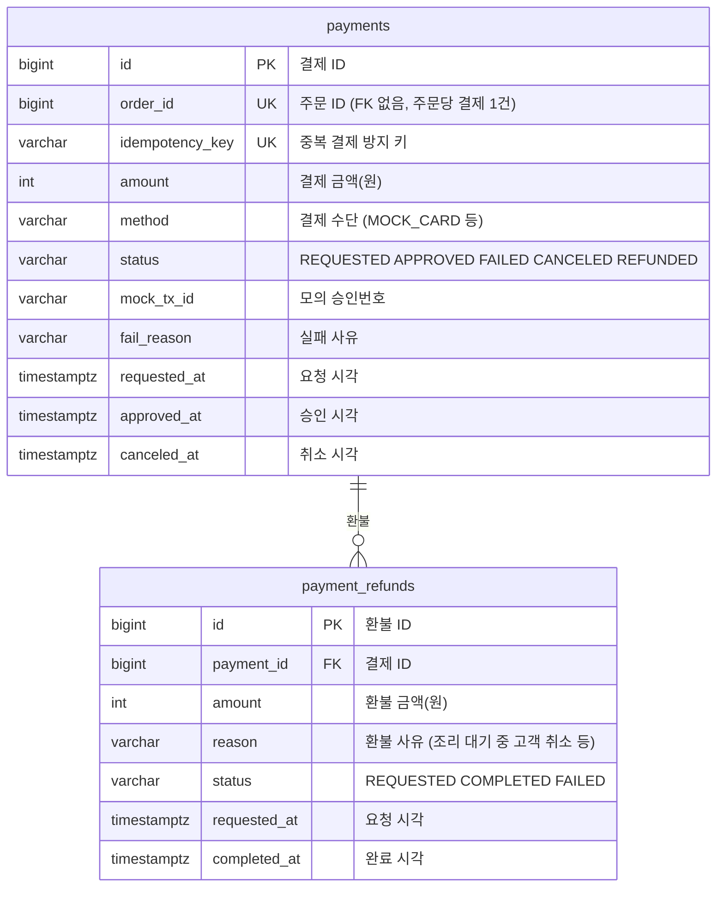
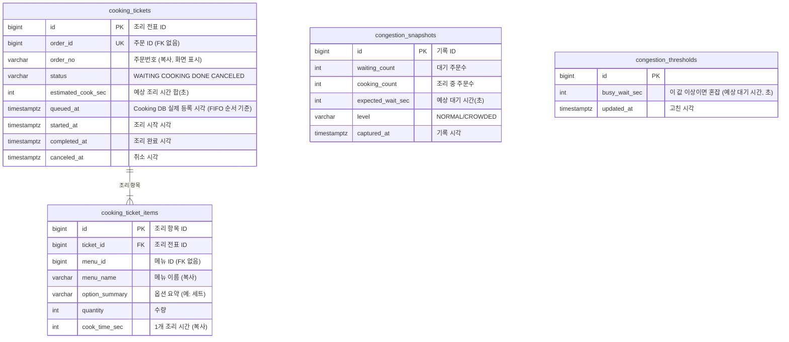
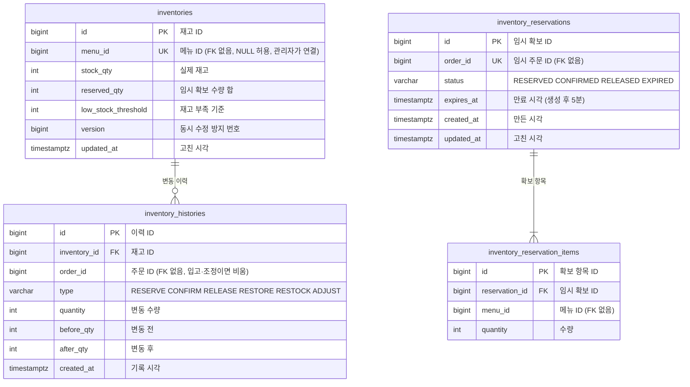
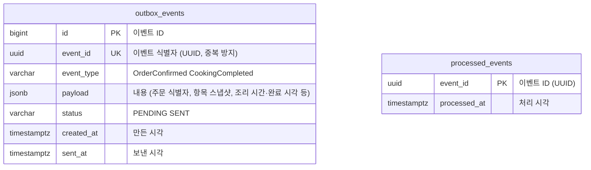
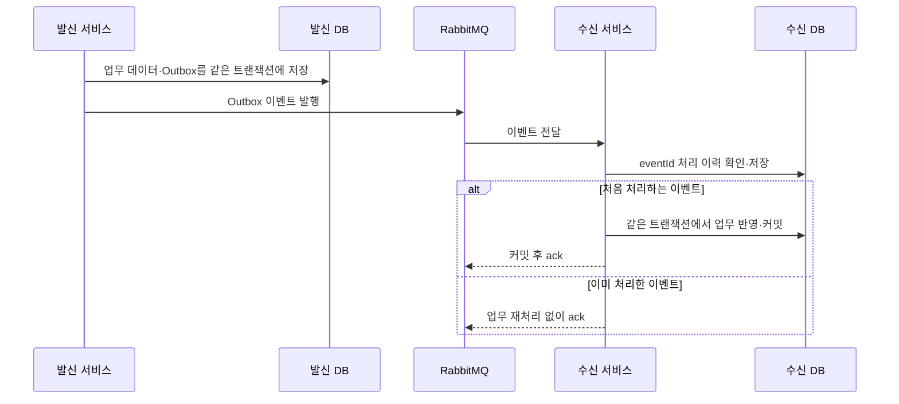

# ERD 초안 — Notion 가져오기

> Notion 원문의 초안을 보관한 문서입니다. Git에 추가했다는 이유로 팀 승인·구현 완료를 의미하지 않습니다.

- 원본: [ERD 초안](https://app.notion.com/p/4102f07e947880fb87eac2ab3ffc68a2)
- 원본 최종 수정: 2026-11-13T03:41:37.090Z (UTC)
- 가져온 날짜: 2026-11-13 (Asia/Seoul)
- 공통 확정 규칙: [CLAUDE.md](../../CLAUDE.md)
- 변경 범위: 문서 형식 변환·자료 분리. API 경로, 필드, 테이블, 상태 및 미결정 사항은 원문을 유지합니다.

---

[dbdiagram.io](https://dbdiagram.io/e/6aed7a52f1d298b573866ae1/6aed7a757ded3580fac8723e)로 이동  내용은 볼수 있지만 추후에 수정이 불가능해서 임의대로 수정가능한 걸루 다시 만들었습니다.

> **초안입니다. 누구나 이 페이지를 직접 고쳐도 됩니다.**
>
> 확정되면 원본(DBML)을 GitHub `docs/erd.dbml`로 올리고, 그 뒤 수정은 PR로 합니다.

> 보관용 옛 ERD는 [과거 자료](archive/notion-legacy.md)로 분리했습니다. 현재 구현 기준으로 사용하지 않습니다.

---

## 1. ERD가 뭔가요?

ERD(Entity Relationship Diagram)는 **DB에 어떤 표를 만들고, 표끼리 어떻게 이어지는지** 그린 설계도입니다.

| ERD 용어 | 쉽게 말하면 | 예시 |
| --- | --- | --- |
| 테이블(표) | 엑셀 시트 한 장 | `orders` = 주문 시트 |
| 컬럼 | 시트의 열(칸 제목) | `order_no`, `status` |
| 행 | 시트의 한 줄 = 데이터 1건 | 주문 1건 |
| 관계(연결선) | 시트끼리 "이 줄은 저 줄과 관련 있음" | 주문 1건에 주문 항목 여러 개 |

## 2. 그림 읽는 법

| 표시 | 뜻 |
| --- | --- |
| PK (Primary Key) | 한 줄을 구분하는 번호. 주민번호처럼 겹치지 않음 |
| FK (Foreign Key) | 다른 표의 PK를 가리키는 칸. DB가 "없는 번호는 못 넣게" 막아 줌 |
| UK (Unique Key) | 표 안에서 같은 값이 두 번 들어갈 수 없는 칸 |
| 실선 | 같은 서비스 DB 안의 진짜 연결(FK 있음) |
| 점선 | 다른 서비스 표의 ID만 적어 둔 것(FK 없음, 필요하면 API로 물어봄) |
| 선 끝이 새발(여러 갈래) 모양 | "여러 개" 쪽. 예: 주문 1건 ↔ 주문 항목 여러 개 |
| 선 끝이 동그라미 + 막대 | "없거나 1개" 쪽. 예: 주문 1건 ↔ 결제 0\~1건 |

**왜 서비스 간에는 FK가 없나요?** 서비스마다 DB가 따로라서 DB끼리는 FK를 걸 수 없고, 걸면 서비스가 DB 단위로 묶여 MSA로 나눈 의미가 사라집니다. 그래서 다른 서비스의 ID는 숫자만 저장하고, 정합성은 API 호출과 RabbitMQ 이벤트로 맞춥니다.

---

## 3. ERD

표가 많아서 한 장에 다 넣으면 글자가 너무 작아져서, 전체 지도 1장 + 서비스별 상세 6장 + 이벤트용 표 1장으로 나눴습니다. 코드 블록 위 보기 방식을 미리 보기로 바꾸면 그림이 보이고, 표를 고치려면 해당 블록의 코드를 직접 수정하면 됩니다.

> 11/13 확정 규칙: 서비스별 독립 DB dev 6개·prod 6개, 테이블명은 복수형 snake\_case, 변경은 Flyway로 관리합니다. 아래 최신 ERD의 테이블명을 이 규칙에 맞춰 통일했습니다. DB의 실제 환경별 접속 이름은 배포 설정에서 관리합니다.

### 3-1. 전체 지도 — 서비스 간 연결만

서비스(DB)마다 대표 표만 골라 서로 어떻게 이어지는지 보여 줍니다. 서비스 사이의 연결은 모두 점선(ID 참조, FK 없음)이고, 같은 DB 안의 실선은 주문 ↔ 주문 항목 한 곳만 그렸습니다. 칸은 각 서비스 상세(3-2\~3-7)에 있습니다. (이벤트용 표 `outbox_events`, `processed_events`는 3-8에)

### 3-2. 회원 (auth\_svc)

회원가입(이메일=아이디 중복 확인, 이용약관·개인정보 동의), 로그인 상태 유지, 마이페이지(닉네임), JWT role(CUSTOMER · STORE\_ADMIN). Access Token과 Refresh Token을 쓰며, 재발급(POST /api/v1/auth/refresh)과 로그아웃(POST /api/v1/auth/logout)을 지원합니다.

### 3-3. 메뉴 (menu\_svc)

메뉴 검색, 이미지, 상세 모달의 옵션(단품/세트)·수량, 판매 상태, 대기·조리시간 계산에 쓸 조리시간. 품절 여부는 Menu DB에 저장하지 않고 Inventory에서 판단합니다(RabbitMQ 이벤트는 현재 미구현). 메뉴의 `status는 ON_SALE(판매) · PAUSED(일시 중지) · HIDDEN(비공개·논리 삭제) 세 가지이며,` 삭제 기능은 HIDDEN 상태 변경으로 처리합니다.

### 3-4. 주문 (order\_svc) — 핵심 흐름

주문하기를 누르면 `orders`와 `order_items`이 만들어지고(CREATED), 재고 확보 → 결제 → 조리 등록 순서로 상태가 바뀝니다. 장바구니(`cart` 계열)는 프론트엔드(React localStorage)에서만 관리하므로 이 ERD에서 제거했고, 주문 시 서버가 메뉴·옵션·가격·재고를 다시 검증합니다. 결제 전에 임시 주문을 먼저 만들어 orderId를 발급하고, 메뉴 검증·재고 확보 후 모의 결제를 거쳐 결제와 재고 확정이 성공하면 고객 표시용 order\_no를 발급합니다. 확정되지 않은 임시 주문은 DB에 남기되 실제 주문 목록에서는 제외하고, 결제 실패 후 재시도하면 새 임시 주문을 만듭니다(별도 checkout 표 없음). store\_operations은 매장 영업·주문 접수 상태(OR-07, OR-08)를 저장합니다. 

**조리 완료 상태 연동**

Cooking Service에서 조리가 완료되면 `CookingCompleted` 이벤트를 통해 Order Service에 완료 사실을 전달합니다. Order Service는 이벤트의 `orderId`로 해당 주문을 확인하고, `orders.status`를 `COMPLETED`로 변경하며 완료 시각을 `completed_at`에 기록합니다. 상태 변경 이력은 `order_status_histories`에 저장하고, `processed_events`를 활용하여 이벤트 중복 처리를 방지합니다.

### 3-5. 결제 (payment\_svc)

모의 결제 요청·결과, 취소·환불. 밖에 열리지 않고 order만 호출합니다. 주문당 결제 기록은 최대 1건이라 order\_id에 UNIQUE를 둡니다. 같은 요청이 두 번 와도 한 번만 처리되도록 `idempotency_key`를 둡니다.

### 3-6. 조리 (cooking\_svc)

홈 화면의 현재 혼잡도·대기 주문수·예상 대기 시간은 `cooking_tickets` 상태로 계산해 Redis에 캐시합니다. `congestion_snapshots`은 이력용 선택 표입니다. 조리 대기열은 RabbitMQ OrderConfirmed 이벤트로 등록하고 조리가 끝나면 CookingCompleted 이벤트로 Order에 알리며, 조리 순서(FIFO)는 Cooking DB에 실제 등록된 순서를 기준으로 합니다.

**대기열 등록 및 조리 완료 처리**

Cooking Service는 `OrderConfirmed` 이벤트를 수신하면 `cooking_tickets`과 `cooking_ticket_items`을 생성하고, 상태를 `WAITING`으로 설정합니다. 이때 `queued_at`에 실제 등록 시각을 기록하며, `order_id`의 UNIQUE 제약과 `processed_events`를 통해 중복 등록을 방지합니다.

조리가 시작되면 상태를 `COOKING`으로 변경하고 `started_at`을 기록합니다. 조리 완료 시에는 상태를 `DONE`으로 변경하고 `completed_at`을 기록한 뒤, `CookingCompleted` 이벤트를 발행합니다.

### 3-7. 재고 (inventory\_svc)

재고 임시확보(기본 5분·테스트 10초, STOCK\_HOLD\_TTL) → 확정(차감) → 해제/복원. 품절 여부는 Inventory가 판단하고 Menu는 API로 조회합니다(품절·재입고 RabbitMQ 이벤트는 현재 미구현). 임시 확보·확정·해제에는 임시 orderId를 쓰고, menu\_id는 NULL 허용·UNIQUE로 두어 관리자가 메뉴와 명시적으로 연결합니다. 재고·확보 상태와 expires\_at은 DB에 저장합니다. Redis는 만료 타이머를 보조하며, Redis 유실 시에도 DB 기준 스케줄러로 만료 처리합니다.

### 3-8. 이벤트용 표 (Order·Cooking 공통)

수정 전

메시지가 중복으로 와도 한 번만 처리하기 위한 표입니다. RabbitMQ는 OrderConfirmed(Order → Cooking, 조리 대기열 등록)와 CookingCompleted(Cooking → Order, 주문 완료 반영) 두 이벤트에만 씁니다. 메뉴 변경·품절 이벤트는 현재 구현하지 않으며, Order DB와 Cooking DB가 각각 `outbox_events와` `processed_events`를 자기 DB에 둡니다.

이벤트를 잃어버리거나 두 번 처리하지 않기 위한 표입니다. RabbitMQ는 OrderConfirmed(Order → Cooking, 조리 대기열 등록)와 CookingCompleted(Cooking → Order, 주문 완료 반영) 두 이벤트에만 씁니다. 메뉴 변경·품절 이벤트는 현재 구현하지 않으며, Order DB와 Cooking DB가 각각 `outbox_events`와 `processed_events`를 자기 DB에 둡니다.

- `outbox_events` (유실 방지): 보내는 쪽은 업무 데이터와 이벤트를 같은 트랜잭션으로 저장한 뒤 RabbitMQ로 발행합니다.
- `processed_events` (중복 방지): 받는 쪽은 한 트랜잭션 안에서 ① `processed_events`에 eventId 저장 → ② 업무 처리(전표 생성 / 주문 완료) → ③ 커밋 후 RabbitMQ에 ack 순서로 처리합니다. ①에서 이미 있는 eventId면 업무 처리 없이 ack만 합니다.
- 두 번째 안전장치: `cooking_tickets.order_id` UNIQUE로 같은 주문의 전표가 두 번 생기지 않습니다.

## 4. 왜 이렇게 설계했나요?

### 전체 원칙

| 설계 | 이유 |
| --- | --- |
| 서비스마다 독립 DB를 둠(dev 6개·prod 6개) | MSA 원칙: 각 서비스는 **자기 데이터만** 갖고, 다른 서비스 DB는 직접 읽거나 고치지 않습니다 |
| 서비스끼리는 FK 없이 **ID만 저장** (그림의 점선) | DB가 다르면 FK를 걸 수 없습니다. 필요한 정보는 API나 이벤트로 주고받습니다 |
| 매장 범위 | 현재 단일 매장. 모든 테이블에 store\_id를 일괄 추가하지 않음 |
| 관리자 기능 | 별도 admin 서비스 없이 업무 소유 서비스의 관리자 API로 제공. 시스템 관측은 Grafana 사용 |

### 주문과 재고의 책임 분리

| 설계 | 이유 |
| --- | --- |
| `inventories`에 `stock_qty`(실제 재고)와 `reserved_qty`(결제 중 잡아 둔 수량)를 따로 둠 | 남은 재고 = `stock_qty - reserved_qty`. 결제 진입 시 `reserved_qty`를 올리고, 결제 성공 시 둘 다 내리고, 만료되면 `reserved_qty`만 내립니다. 둘 다 0 미만이 될 수 없게(CHECK) 해서 **초과 판매를 막습니다** |
| `inventory_reservations `(결제 전 재고 확보) | 임시 주문의 orderId로 재고를 먼저 잡아 두고(RESERVED), 결제·재고 확정 시 CONFIRMED, 실패하거나 expires\_at이 지나면 RELEASED·EXPIRED로 돌려주기 위해서입니다 |
| `idempotency_key` (UK) | 결제 버튼을 두 번 눌러도 결제·차감이 **한 번만** 되게 합니다 |
| `임시 Order 먼저 생성 (별도 checkout 표 없음)` | 결제 전에 orderId를 발급하고 메뉴 검증·재고 확보 후 결제합니다. 확정되지 않은 임시 주문은 남기되 주문 목록에서 제외하고, 재시도는 새 임시 주문으로 합니다 |
| 주문 항목에 메뉴 이름·가격·조리 시간을 복사해서 저장 | 나중에 메뉴 가격이 바뀌어도 그 주문은 **주문 당시 값**이 남아야 하고, 매번 메뉴 서비스에 물어보지 않아도 됩니다 |
| `order_no (UK)` | 고객·관리자 화면에 같은 주문번호가 두 번 나오지 않게 합니다. 결제·재고 확정 후에만 발급하고, 임시 주문은 NULL입니다 |
| `store_operations` | 관리자가 OR-06·OR-07로 조회·변경하는 영업(is\_open)·주문 접수(accepting\_orders) 상태입니다. Cooking 장애에 따른 주문 차단은 이 설정과 별개로 적용합니다 |

### 이벤트를 안전하게 주고받기

| 설계 | 이유 |
| --- | --- |
| `outbox_events` (보낼 이벤트) | "주문 저장”과 “이벤트 보내기”를 같은 DB 저장으로 묶습니다. 저장은 됐는데 이벤트가 안 나가는 일을 막는 방법(아웃박스 패턴)입니다. event\_id(UUID, UNIQUE)로 이벤트를 구분하며 OrderConfirmed·CookingCompleted에 씁니다. Order DB와 Cooking DB에 각각 둡니다 |
| `processed_events` (처리한 이벤트) | 같은 이벤트가 두 번 도착해도 한 번만 처리하도록 받은 이벤트 ID(UUID, PK)를 적어 둡니다. Order DB와 Cooking DB에 각각 둡니다 |

### 조리 (cooking\_svc)

| 설계 | 이유 |
| --- | --- |
| Cooking DB에 실제 등록된 순서 = FIFO 순서 | 먼저 등록된 주문부터 조리합니다 |
| 매장마다 `COOKING` 상태는 최대 1건 | "동시에 조리하는 주문 최대 1건" 규칙을 DB에서도 지킵니다 |
| `version` | "조리 시작"과 "고객 취소"가 동시에 일어나도 둘 중 하나만 성공하게 합니다 |
| 조리 상태와 시각(`queued_at`, `started_at`, `completed_at`)을 DB에 저장 | 파드가 재시작돼도 조리 상태가 사라지지 않습니다 |

### 혼잡도(Cooking 소속) · 회원(Auth)

| 설계 | 이유 |
| --- | --- |
| `congestion_thresholds` | 매장 관리자가 정하는 NORMAL/CROWDED 2단계 혼잡도 기준값 |
| `congestion_snapshots` | 혼잡 등급이 바뀔 때마다 한 줄씩 남겨 시간에 따른 변화를 볼 수 있게 합니다 |
| `users.role 2종 (CUSTOMER · STORE_ADMIN)` | 고객과 매장 관리자를 한 표에서 관리하고, 역할로 권한을 나눕니다. 시스템 운영자는 Auth 권한으로 관리하지 않고 Grafana로 분리합니다 |
| `password_hash` | 비밀번호는 원문이 아니라 해시로만 저장합니다 |
| 소셜 로그인 | 범위·추가 테이블은 추후 검토. 현재 구현 기준은 위 Auth ERD |

## 5. 함께 정할 것

- [x] 확보 유효시간: 기본 5분·테스트 10초, ConfigMap STOCK\_HOLD\_TTL(11/12 확정)
- [ ] 관리자 작업 기록(SHOULD 4: 누가 언제 접수 중지·재고 수정을 했는지)을 남길 표가 아직 없음
- [ ] 소셜 로그인을 MUST로 할지 (외부 앱 등록 필요)
- [ ] 화면 예시의 인기 메뉴·선호도는 이 ERD에 없음. 넣을지 뺄지

## 6. 고치는 방법

- **지금(초안)**: 이 페이지의 코드 블록을 직접 수정하고, 바꾼 이유를 아래에 한 줄 남겨 주세요
- **확정 후**: 원본 DBML을 GitHub `docs/erd.dbml`로 올리고, 그다음부터는 브랜치 → PR로 수정합니다

### 수정 기록

| 날짜 | 누가 | 무엇을 | 왜 |
| --- | --- | --- | --- |
| 2026-11-12 | 김민규 | 장바구니 3표 제거, 임시 Order(order\_no NULL 허용)·store\_operation 추가, Menu status ON\_SALE/PAUSED/HIDDEN, role CUSTOMER/STORE\_ADMIN, payment.order\_id UK, inventory.menu\_id NULL 허용·UK, outbox/processed\_event UUID(event\_id) | 11/11 팀 회의록 결정사항 반영 |
| 2026-11-12 | 김민규 | 3-6 조리 congestion\_threshold 테이블 추가 congestion\_snapshot 테이블 수정 | 혼잡도 계산 시 기준값 추가를 위해 |
| 2026-11-12 | 남규리 | 3-8 설명 보완 (outbox·processed 역할, 중복 처리 순서) | 11/11 회의 결정 반영, 이벤트 중복 처리 방지 |
| 2026-11-12 | 이태훈 | 3-4, 3-6 설명 보완 (대기열 등록 및 조리 완료 상태 연동)  | 11/12 팀 회의록 반영 주문 확정 후 대기열 등록 및 조리 완료 후 주문상태 반영 절차 명확화 |

## 이벤트 저장·중복 방지 흐름

OrderConfirmed의 발신자는 Order·수신자는 Cooking이며, CookingCompleted는 반대 방향입니다. outbox\_events와 processed\_events는 두 서비스가 각각 자기 DB에 둡니다. 발행 확인·재시도·실패 메시지 정책의 세부 값은 미결정 사항을 유지합니다.
